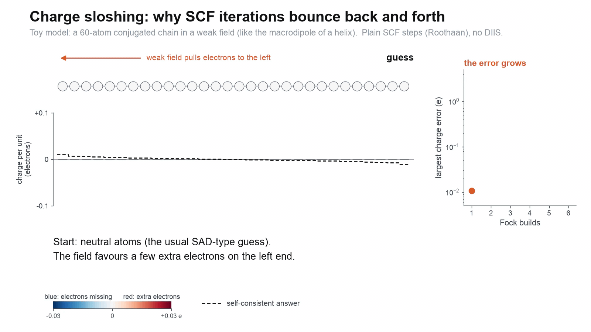
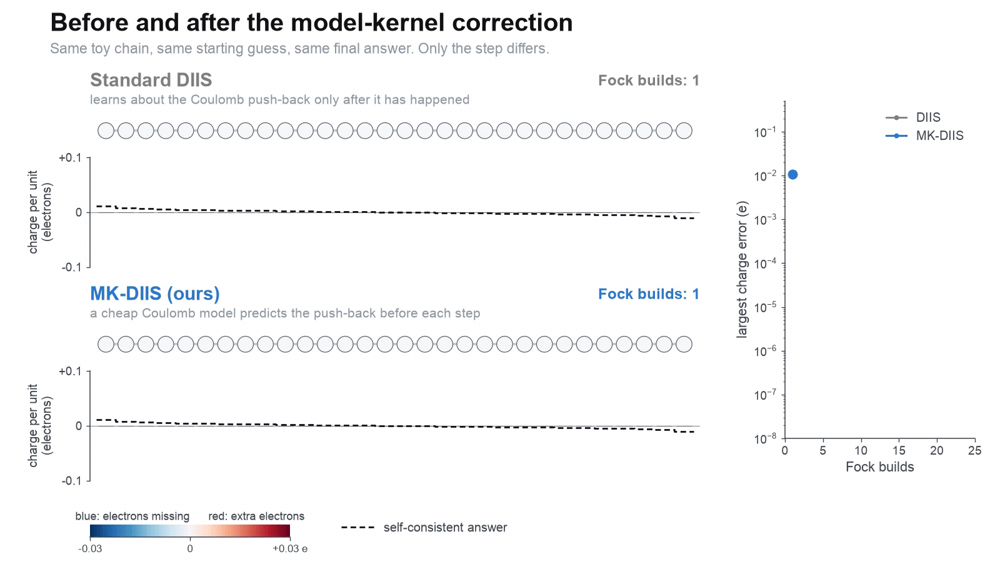
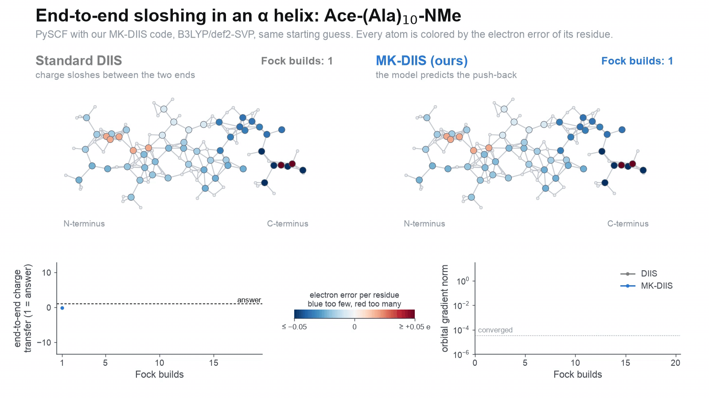
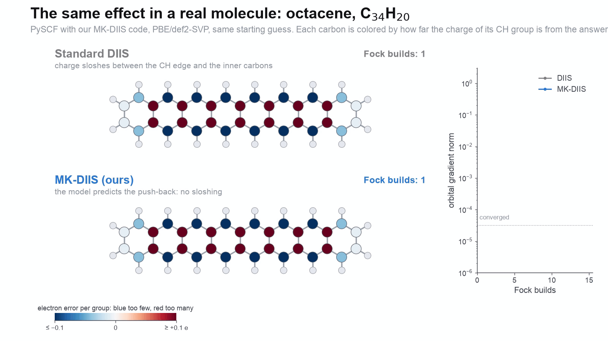

# MK-DIIS: model-kernel corrected DIIS

MK-DIIS speeds up the self-consistent field (SCF) iteration of Hartree–Fock and Kohn–Sham DFT in PySCF. Every DIIS
step diagonalizes an extrapolated Fock matrix and fills the lowest orbitals (the Roothaan step), as if the Fock matrix
stayed fixed while the electrons move. It does not: the moved electrons repel, the potential pushes back, and the
next step has to undo part of the last one. MK-DIIS predicts this push-back with a cheap model of the Coulomb
response and takes a step that already accounts for it. It needs no extra Fock build, costs about 1% of the run
time, has no system-specific parameter, and reaches the same solution as DIIS.

This repository contains the implementation, the benchmark driver and test sets, and the scripts for the toy
model, the figures and the animations of the paper

> F. Sun, M. Y. Li, H. Cheng, J. Cong, Y. Sun. *Model-Kernel Corrected DIIS: Cheap Response Information for the
> Roothaan Step.* In preparation.

## Charge sloshing, and what the model changes

**The problem.** A toy model of a long conjugated molecule (a chain of 60 sites in a weak field) iterated with
plain Roothaan steps: each step over-corrects, and the charge swings from end to end with a growing amplitude.
Each circle is one strongly bonded pair of sites, so the 60 sites appear as 30 circles; adding up the charge of a pair
removes the alternation of the charge within it, which is not part of the sloshing.



**Before and after.** Same chain, same starting guess, same answer: DIIS needs 23 Fock builds, MK-DIIS 9.



**A real molecule.** The α helix Ace-(Ala)<sub>10</sub>-NMe (B3LYP/def2-SVP, 112 atoms). Its dipole measures the
charge moved between the two ends: under DIIS it swings to −11.6 and then +11 times its final value; MK-DIIS gets
1.03 on the first step and converges in 9 Fock builds instead of 19.



**Octacene** (PBE/def2-SVP): the charge between the CH edge and the inner carbons, as a fraction of its final
value, goes 65 → 199 → 57 → 115% under DIIS and 133 → 96 → 101% under MK-DIIS; 14 against 7 Fock builds.



## How it works

In the basis of the Roothaan orbitals of the DIIS-extrapolated Fock matrix, MK-DIIS solves the linearized model
problem

    (Ω + K̃) κ = −g,      g = [K̃ (D_R − D̄)]_vo,      Ω_ai = ε_a − ε_i,

and rotates the occupied orbitals into the virtual ones by κ. Here D̄ is the extrapolated density, D_R the density
of the Roothaan step, and K̃ a model of the response kernel: the Hartree (Coulomb) kernel fitted in a minimal
auxiliary basis of one s, p and d Gaussian per atom with exponents θ/R<sub>cov</sub>², as in TDDFT-ris. K̃ = 0 is
plain DIIS; the exact kernel would make it a Newton step on the DIIS model. Because only the occupied–virtual part
of the push-back changes the next density, a coarse model of the long-range Coulomb response is enough, and the
correction is low-rank. At convergence the Roothaan step no longer moves the density, so the correction vanishes
and the result solves the exact SCF equations: the model affects the speed, not the answer.

In plane-wave language this is a dielectric preconditioner of the Roothaan residual with the roles reversed: the
independent-particle response is exact (from the orbital energies), and the Coulomb kernel is modelled.

| | Fock builds relative to DIIS |
|---|---|
| 120 tmQM transition-metal complexes / 50 organic molecules (B3LYP/def2-SVP) | 0.65 / 0.63 |
| 16 large molecules, 36–304 atoms (Trp-cage: 24 → 9 builds) | 0.53 |
| against Q-Chem's DIIS at the same threshold, tmQM / organic | 0.66 / 0.62 |
| AURORA-SCF on 40 tmQM / 50 organic, for comparison | 1.03 / 0.69 (MK-DIIS: 0.61 / 0.63) |

## Installation

```bash
git clone https://github.com/FrancoTSolis/mkdiis.git
cd mkdiis
pip install -e .              # numpy, scipy, PySCF >= 2.13
pip install -e ".[viz,test]"  # matplotlib and Pillow for the animations, pytest
```

The animations also need [ffmpeg](https://ffmpeg.org).

## Usage

```python
from pyscf import gto, dft
import mkdiis

mol = gto.M(atom="""N -1.876 0.267 0.000; C -0.584 -0.389 0.000; C 0.590 0.574 0.000; O 0.430 1.783 0.000
                      O 1.799 -0.010 0.000; H -2.594 -0.443 0.000; H -1.997 0.888 0.807; H -0.505 -1.034 0.880
                      H -0.505 -1.034 -0.880; H 2.474 0.692 0.000""", basis="def2-svp")   # glycine
mf = dft.RKS(mol, xc="b3lyp")
mkdiis.kernel(mf)                  # MK(spd); afterwards mf.e_tot, mf.mo_energy, mf.mo_coeff, ... as after mf.kernel()
print(mf.mkdiis_stats["nfock"])    # Fock builds, counting the initial guess
```

`mkdiis.kernel(mf, model="spd", dm0=None, solver="auto", **options)` works for RHF/RKS and UHF/UKS objects,
including density-fitted and PCM ones. Useful options:

| option | meaning |
|---|---|
| `model` | `"spd"` (default), `"s"`, `"jfit"` (full fitting basis, close to the exact Hartree kernel), `"exact"` (exact kernel, an upper bound that costs response builds), `None` (plain DIIS), or an `AuxHartreeModel` |
| `solver` | `"lowrank"` (Woodbury) or `"cg"` (AO-direct conjugate gradients, low memory); `"auto"` switches to CG above 1000 basis functions |
| `accel="adiis"` | ADIIS for the first steps, then DIIS; for poor starting guesses (Hu and Yang 2010) |
| `model_on_grad=0.05` | let DIIS take the first steps and switch the model on below this orbital-gradient norm; recommended for open shells |
| `smearing=0.005` | Fermi–Dirac occupations of this width (Hartree); the model then includes the density-of-states term at the Fermi level |
| `conv_tol`, `max_cycle`, `max_rot` | energy threshold (1e-9 Hartree; the gradient threshold is its square root, as in PySCF), cycle limit, cap on the rotation per step (0.3 rad) |

`mkdiis.run_scf(mf, dm0, model=mkdiis.AuxHartreeModel("spd"), ...)` is the lower-level driver; it returns the
statistics (Fock builds, wall time, time spent on the model, the convergence history) together with the final density
and orbitals. `AuxHartreeModel(kind, theta=0.2, store="dense"|"tril", screen=0.0, exchange=False)` builds the model
kernel for any PySCF auxiliary basis; `exchange=True` adds the exact exchange of a hybrid functional in the same
basis.

For open shells, check the converged solution with `mkdiis.internal_stability(mf, mo_coeff, mo_occ)`, a block
Davidson search for a negative orbital-Hessian eigenvalue that is more reliable than a single-vector start; on
instability it returns orbitals rotated along the unstable mode, from which to restart. See
[`examples/open_shell.py`](examples/open_shell.py).

## Examples

| script | what it shows |
|---|---|
| [`examples/quickstart.py`](examples/quickstart.py) | hexacene (PBE/def2-SVP): DIIS 13 Fock builds, MK-DIIS 7 |
| [`examples/open_shell.py`](examples/open_shell.py) | a titanium complex from tmQM as a triplet, with the delayed model and the stability check: DIIS 42 Fock builds, MK-DIIS 26, same stable solution |
| [`examples/metal_cluster.py`](examples/metal_cluster.py) | Al<sub>13</sub><sup>−</sup> with Fermi smearing: smeared DIIS 10 Fock builds, MK-DIIS 7 |

## Reproducing the paper

`benchmarks/bench.py` runs one method on one system and writes a JSON record; `benchmarks/summarize.py` turns a
directory of records into success counts, median builds and geometric-mean ratios against DIIS. For example, the
closed-shell benchmark of Table 1:

```bash
cd benchmarks
for i in $(seq 0 119); do for m in diis mk_s mk_spd mk_jfit; do
  python bench.py --system tmqm:$i:singlet --method $m --out results/tmqm/tmqm_${i}_singlet__$m.json
done; done
for i in $(seq 0 49); do for m in diis mk_s mk_spd mk_jfit; do
  python bench.py --system organic:$i --method $m --out results/organic/organic_${i}__$m.json
done; done
python summarize.py results/tmqm
python summarize.py results/organic
```

| paper | systems | options |
|---|---|---|
| Table 1, closed shells | `tmqm:<i>:singlet`, `organic:<i>` | `--method diis mk_s mk_spd mk_jfit mk_exact`; `--guess atom` or `sap` for the other guesses; `--method pyscf_soscf_dfh` for second order |
| Table 2, other models and starting points | the first 40 tmQM complexes and the 50 organic molecules | `--xc hf` or `wb97x`, `--method mk_spd_k` (exchange in the model), `--basis def2-tzvp` or `def2-svpd`, `--solvent water`, `--perturb 0.03` (restart) |
| Table 3, other accelerators | same subset | `--method aurora aurora_auxfull` (needs `pip install pyscf-aurora`) |
| Table 4, large molecules | `large:<name>` (`C24H12`, `C54H18`, `C96H24`, `thio6`, `thio10`, `h2tpp`, `zntpp`, `ala10`, `ala15`, `ala20`, `trpcage`, `water51`), `acene:<n>` | `--method diis mk_spd_cg`; `timing.py large:<name>` for the cost per cycle |
| Table 5, poor guesses | `tmqm:<i>:singlet`, `organic:<i>` | `--guess core --method diis mk_spd adiis adiis_mk_spd` |
| Table 6, metal clusters | `ico:<El>:<charge>` | `--smearing 0.002`, `0.005` or `0.01`; `--no_intraband` drops the Fermi-level term |
| Tables 7–8, open shells | `tmqm:<i>:triplet`, `radical:<i>` | `--on_grad 0.05` (delayed model), `--stab 2 --stab_mode block`; `classify.py` tells minima from saddle points |

The test sets are in `benchmarks/data`: `organic.json`, 50 common drug-like molecules from PubChem
(`prep_pubchem.py`); `tmqm_small.json`, 120 complexes drawn at random (seed 0) from the 747 complexes of the tmQM
set with fewer than 20 atoms (`prep_tmqm.py`); and `large.json`, the large molecules (`prep_large.py`, needs RDKit).
The Q-Chem baselines of the paper were run with Q-Chem 6.4 and are not part of this repository.

## Animations and figures

```bash
cd animations
python anim_sloshing.py        # toy chain: out/sloshing_problem.mp4, out/sloshing_before_after.mp4
python real_figure.py          # octacene, from data/trace_acene8.npz (recompute with: python real_trace.py acene:8)
python helix_figure.py         # the helix, from bench.py --trace records in data/
python paper_figs.py           # Figures 2 and 3 of the paper: static versions of these animations
python sloshing_static.py      # space–iteration maps of the toy chain
./make_gifs.sh                 # the GIFs above, in media/
```

`toy_chain.py` is the toy model: a half-filled chain with alternating hopping in a weak field, a Hartree plus local
exchange–correlation mean field, and the same DIIS and MK-DIIS steps as the molecular code.

## Tests

```bash
pytest          # about a minute
```

## Citation

```bibtex
@unpublished{sun2026mkdiis,
  author = {Sun, Fang and Li, Miranda Yang and Cheng, Hekai and Cong, Jason and Sun, Yizhou},
  title  = {Model-Kernel Corrected {DIIS}: Cheap Response Information for the Roothaan Step},
  note   = {In preparation},
  year   = {2026}
}
```

## License

Apache License 2.0; see [LICENSE](LICENSE).
